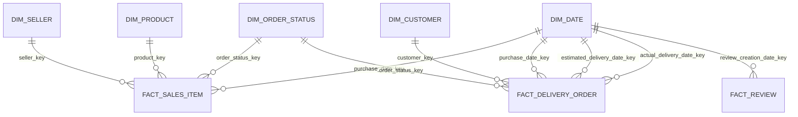

# Thiết kế kho dữ liệu Olist phục vụ phân tích hiệu quả bán hàng và chất lượng giao hàng

**Mã học phần:** CO4031  
**Nguồn dữ liệu:** Olist Brazilian E-Commerce Public Dataset  
**Phiên bản tài liệu:** 1.0 — phản ánh mô hình PostgreSQL và luồng ETL V1 hiện có  
**Trạng thái:** Đã triển khai và kiểm thử ETL trên bộ dữ liệu hiện tại

## 1. Mục đích và phạm vi

Tài liệu mô tả mô hình kho dữ liệu đã được triển khai cho đề tài xây dựng kho dữ liệu và hệ hỗ trợ quyết định nhằm phân tích hiệu quả seller và chất lượng giao hàng trên sàn thương mại điện tử. Nội dung được tổ chức theo mô hình dữ liệu, grain, quan hệ khóa, quy tắc biến đổi và giới hạn phân tích để các thành viên có thể sử dụng thống nhất khi phát triển truy vấn, KPI và báo cáo.

Phiên bản V1 cung cấp ba nhóm dữ liệu phân tích:

1. **Chi tiết bán hàng:** phân tích giá trị mặt hàng và phí vận chuyển theo seller, sản phẩm, ngày mua và trạng thái đơn hàng.
2. **Giao hàng ở cấp đơn:** phân tích thời gian giao hàng và mức độ giao trễ ở cấp đơn hàng/toàn sàn.
3. **Đánh giá khách hàng:** phân tích điểm review theo ngày tạo review và liên kết về đơn hàng khi cần.

Phạm vi hiện thực bao gồm PostgreSQL, các bảng dimension/fact, ETL nạp lại toàn bộ dữ liệu (controlled full refresh), log reject và các kiểm tra chất lượng sau nạp. Dashboard, semantic layer, incremental load, lịch sử thay đổi theo thời gian và quy trách nhiệm giao trễ cho seller chưa thuộc phạm vi hiện thực V1.

## 2. Nguồn dữ liệu và phạm vi tích hợp

ETL V1 đọc bảy tệp CSV sau:

| Tệp nguồn                               | Thông tin được sử dụng                                                                                                           |
| --------------------------------------- | -------------------------------------------------------------------------------------------------------------------------------- |
| `olist_orders_dataset.csv`              | Mã đơn, customer, trạng thái, thời điểm mua, thời điểm giao cho đơn vị vận chuyển, thời điểm giao cho khách và ngày giao dự kiến |
| `olist_order_items_dataset.csv`         | Mã đơn, số thứ tự item trong đơn, sản phẩm, seller, giá và phí vận chuyển                                                        |
| `olist_sellers_dataset.csv`             | Mã seller, ZIP prefix, thành phố và bang                                                                                         |
| `olist_products_dataset.csv`            | Mã sản phẩm, danh mục và thuộc tính sản phẩm                                                                                     |
| `olist_customers_dataset.csv`           | Mã customer theo bản ghi đơn hàng, mã customer xuyên nhiều đơn và thông tin địa lý                                               |
| `olist_order_reviews_dataset.csv`       | Mã review, mã đơn, điểm, nội dung bình luận và các mốc thời gian review                                                          |
| `product_category_name_translation.csv` | Bản dịch tiếng Anh cho tên danh mục sản phẩm                                                                                     |

`olist_order_payments_dataset.csv` và `olist_geolocation_dataset.csv` chưa được nạp vào mô hình V1. Vì một đơn có thể có nhiều dòng thanh toán, nhiều review hoặc item từ nhiều seller, không được nối trực tiếp các bảng chi tiết này với `fact_sales_item` mà không tổng hợp về đúng grain; phép nối không kiểm soát có thể nhân bản số liệu.

Trong nguồn sản phẩm, tên cột `product_name_lenght` và `product_description_lenght` được viết như trong dữ liệu gốc; ETL ánh xạ chúng sang cột đích `product_name_length` và `product_description_length`.

Các số lượng bản ghi dưới đây là kết quả profile của bộ CSV đang sử dụng trong quá trình triển khai, dùng làm mốc đối soát chứ không phải ràng buộc cố định của hệ thống:

| Nguồn / bảng đích                             | Số dòng được ghi nhận |
| --------------------------------------------- | --------------------: |
| Orders / `fact_delivery_order`                |                99,441 |
| Order items / `fact_sales_item`               |               112,650 |
| Sellers / `dim_seller`                        |                 3,095 |
| Products / `dim_product`                      |                32,951 |
| Customers / `dim_customer`                    |                99,441 |
| Reviews / `fact_review`                       |                99,224 |
| Trạng thái đơn phân biệt / `dim_order_status` |                     8 |
| Ngày lịch / `dim_date`                        |                   800 |

## 3. Kiến trúc mô hình dữ liệu

Kho dữ liệu được triển khai trong PostgreSQL, schema `dw`. Mô hình sử dụng các bảng dimension để chuẩn hóa các góc nhìn phân tích và các bảng fact để lưu dữ liệu sự kiện ở grain xác định.

### 3.1 Sơ đồ quan hệ logic

Sơ đồ thể hiện các khóa ngoại được khai báo trong DDL. `fact_review.order_id` được lưu để truy vết/liên kết với đơn hàng ở tầng truy vấn, nhưng trong DDL V1 không khai báo khóa ngoại từ bảng này đến `fact_delivery_order` hoặc `dim_customer`. ETL hiện cũng không kiểm tra rằng `fact_review.order_id` phải tồn tại trong orders; điều kiện nhận review là `order_id` và `review_score` không null, đồng thời điểm nằm trong khoảng 1–5. `fact_sales_item.order_id` là khóa nghiệp vụ để nhóm item theo đơn; quan hệ này không thay thế grain item của bảng fact.

### 3.2 Các dimension

#### `dim_date` — chiều ngày

- **Grain:** Một dòng cho mỗi ngày lịch.
- **Khóa chính:** `date_key DATE`.
- **Thuộc tính:** `year`, `quarter`, `month`, `month_name`, `day_of_month`, `day_of_week`, `day_name`, `is_weekend`.
- **Vai trò:** Dùng chung cho ngày mua, ngày giao dự kiến, ngày giao thực tế và ngày tạo review.
- **Cách tạo:** ETL lấy các ngày không null từ thời điểm mua, ngày giao dự kiến, ngày giao thực tế và ngày tạo review, sau đó sinh đầy đủ từng ngày từ ngày nhỏ nhất đến ngày lớn nhất. Do đó bảng ngày không chỉ chứa những ngày xuất hiện trực tiếp trong giao dịch.
- **Bộ dữ liệu hiện tại:** 2016-09-04 đến 2018-11-12, tổng 800 ngày.

`date_key` được dùng trực tiếp dưới kiểu SQL `DATE`; thiết kế không sử dụng số nguyên dạng `YYYYMMDD`.

#### `dim_seller` — chiều seller

- **Grain:** Một dòng cho mỗi `seller_id` trong nguồn.
- **Khóa thay thế:** `seller_key BIGINT` identity.
- **Khóa nghiệp vụ:** `seller_id VARCHAR(64)`, duy nhất.
- **Thuộc tính:** `seller_zip_code_prefix`, `seller_city`, `seller_state`.
- **Sử dụng:** Phân tích giá trị mặt hàng và số đơn có item của seller.

Bản triển khai V1 giữ một bản ghi hiện tại cho mỗi seller và không lưu các phiên bản thuộc tính theo thời gian. Vì ETL hiện chạy full refresh, không có cơ chế nạp thay đổi seller theo kiểu lịch sử; các phân tích theo seller không thể tái hiện thuộc tính seller tại một thời điểm lịch sử.

#### `dim_product` — chiều sản phẩm

- **Grain:** Một dòng cho mỗi `product_id`.
- **Khóa thay thế:** `product_key BIGINT` identity.
- **Khóa nghiệp vụ:** `product_id VARCHAR(64)`, duy nhất.
- **Thuộc tính:** `product_category_name`, `product_category_name_english`, `product_name_length`, `product_description_length`, `product_photos_qty`, `product_weight_g`, `product_length_cm`, `product_height_cm`, `product_width_cm`.
- **Sử dụng:** Phân tích giá trị mặt hàng theo sản phẩm và danh mục.

Bản dịch tên danh mục được ghép vào dữ liệu sản phẩm trước khi nạp. Nếu một danh mục không có bản dịch tương ứng, trường tên danh mục tiếng Anh có thể để null; ETL không tự tạo bản dịch.

#### `dim_customer` — chiều customer

- **Grain:** Một dòng cho mỗi `customer_id` của nguồn.
- **Khóa thay thế:** `customer_key BIGINT` identity.
- **Khóa nghiệp vụ:** `customer_id VARCHAR(64)`, duy nhất.
- **Thuộc tính:** `customer_unique_id`, `customer_zip_code_prefix`, `customer_city`, `customer_state`.
- **Sử dụng trong V1:** Liên kết với `fact_delivery_order` để phân tích giao hàng theo khách hàng và địa lý.

`customer_id` là mã customer gắn với bản ghi khách hàng của đơn trong dataset; `customer_unique_id` được dùng để nhận diện cùng một khách hàng xuyên nhiều đơn. Hai trường không nên được xem là tương đương khi tính số lượng khách hàng duy nhất.

#### `dim_order_status` — chiều trạng thái đơn hàng

- **Grain:** Một dòng cho mỗi giá trị trạng thái không null được tìm thấy trong dữ liệu orders tại lần nạp.
- **Khóa thay thế:** `order_status_key BIGINT` identity.
- **Thuộc tính nghiệp vụ:** `order_status VARCHAR(32)`, duy nhất.
- **Sử dụng:** Liên kết trạng thái đơn với cả `fact_sales_item` và `fact_delivery_order`.

Các trạng thái được giữ riêng biệt; ETL không gộp mọi trạng thái thành đơn hoàn tất. Khi xây dựng KPI bán hàng, cần nêu rõ trạng thái được bao gồm. `fact_sales_item.order_status_key` phản ánh trạng thái nguồn tại lần ETL chạy gần nhất, không phải trạng thái được lưu theo lịch sử tại ngày mua.

### 3.3 Các fact

#### `fact_sales_item` — fact chi tiết mặt hàng

**Grain:** Một dòng cho mỗi cặp `(order_id, order_item_id)`. Đây là grain item trong một đơn hàng, không phải grain đơn hàng.

| Cột                         | Vai trò                                                        |
| --------------------------- | -------------------------------------------------------------- |
| `sales_item_key`            | Khóa thay thế của dòng fact                                    |
| `order_id`, `order_item_id` | Khóa nghiệp vụ của item trong đơn; có ràng buộc unique kết hợp |
| `seller_key`                | Khóa ngoại đến `dim_seller`                                    |
| `product_key`               | Khóa ngoại đến `dim_product`                                   |
| `purchase_date_key`         | Ngày mua, khóa ngoại đến `dim_date`                            |
| `price`                     | Giá của item trong nguồn, kiểu `NUMERIC(14,2)`                 |
| `freight_value`             | Phí vận chuyển gắn với item trong nguồn, kiểu `NUMERIC(14,2)`  |
| `item_count`                | Số lượng dòng item, luôn bằng 1 theo ràng buộc                 |
| `order_status_key`          | Trạng thái của order được tra tại lần ETL hiện tại             |

Các kiểm soát chính trong DDL gồm `price >= 0`, `freight_value >= 0`, `order_item_id > 0`, `item_count = 1`, khóa ngoại đến các dimension và unique constraint trên `(order_id, order_item_id)`. Lưu ý khi đọc DDL: `purchase_date_key` được khai báo nullable trong PostgreSQL, nhưng ETL loại item khỏi fact nếu `order_purchase_timestamp` hoặc trạng thái đơn bị thiếu; vì vậy tính bắt buộc của ngày mua đang được thực thi ở tầng ETL, không phải bằng `NOT NULL` trong DDL.

**Các phép tổng hợp phù hợp:**

- Giá trị mặt hàng: `SUM(price)`.
- Phí vận chuyển: `SUM(freight_value)`.
- Tổng giá trị cộng phí vận chuyển có thể tính riêng từ hai đại lượng trên nếu mục tiêu báo cáo yêu cầu.
- Số item: `SUM(item_count)` hoặc số dòng fact sau khi bảo đảm grain không trùng.
- Số đơn theo seller: `COUNT(DISTINCT order_id)` trong ngữ cảnh seller.

`price` không phải lợi nhuận và không tự động đại diện cho doanh thu thuần. Mô hình V1 không có dữ liệu chi phí, hoàn tiền hoặc điều chỉnh doanh thu để tính lợi nhuận.

Một đơn có thể có nhiều item và có thể có item từ nhiều seller. Vì vậy, khi báo cáo theo seller, một order có nhiều seller sẽ được tính một lần trong số đơn của mỗi seller xuất hiện trong order đó. Không cộng `COUNT(order_id)` ở grain item để suy ra số đơn.

#### `fact_delivery_order` — fact giao hàng cấp đơn

**Grain:** Một dòng cho mỗi `order_id`; cột `order_id` có ràng buộc unique.

| Cột                             | Vai trò                                                 |
| ------------------------------- | ------------------------------------------------------- |
| `delivery_key`                  | Khóa thay thế                                           |
| `order_id`                      | Khóa nghiệp vụ duy nhất của đơn                         |
| `customer_key`                  | Khóa ngoại đến `dim_customer`                           |
| `purchase_date_key`             | Ngày mua                                                |
| `estimated_delivery_date_key`   | Ngày giao dự kiến                                       |
| `actual_delivery_date_key`      | Ngày giao thực tế cho khách                             |
| `order_status_key`              | Trạng thái đơn                                          |
| `order_purchase_timestamp`      | Timestamp mua gốc                                       |
| `order_estimated_delivery_date` | Timestamp/ngày giao dự kiến gốc                         |
| `order_delivered_customer_date` | Timestamp giao thực tế gốc                              |
| `delivery_days`                 | Số ngày lịch từ ngày mua đến ngày giao thực tế          |
| `delay_days`                    | Số ngày lịch từ ngày giao thực tế trừ ngày giao dự kiến |
| `is_delayed`                    | Cờ giao trễ; có thể null nếu không đủ điều kiện         |
| `is_delivery_eligible`          | Cờ xác định đơn có đủ điều kiện tính KPI giao hàng      |

**Quy tắc eligibility được hiện thực trong ETL:** đơn chỉ đủ điều kiện khi `order_status = 'delivered'`, thời điểm giao thực tế và thời điểm giao dự kiến đều có giá trị. `delivery_days` được tính khi đơn đủ điều kiện và ngày mua có giá trị; `delay_days` được tính khi đơn đủ điều kiện. Đơn không đủ điều kiện vẫn được giữ trong fact nếu các khóa bắt buộc của đơn hợp lệ, nhưng `is_delivery_eligible = false`, `delay_days = NULL` và `is_delayed = NULL`.

Cách tính:

- `delivery_days = DATE(order_delivered_customer_date) - DATE(order_purchase_timestamp)`.
- `delay_days = DATE(order_delivered_customer_date) - DATE(order_estimated_delivery_date)`.
- `is_delayed = (delay_days > 0)` đối với đơn đủ điều kiện.
- `delay_days < 0`: giao sớm; `delay_days = 0`: giao đúng ngày dự kiến; `delay_days > 0`: giao trễ.

ETL loại dòng nếu ngày giao thực tế trước ngày mua trong trường hợp được xác định đủ điều kiện. DDL còn có kiểm tra `delivery_days` không âm khi có giá trị và ràng buộc nhất quán cơ bản giữa eligibility và cờ giao trễ.

**KPI chuẩn dùng cho báo cáo:**

- Số đơn đủ điều kiện: đếm dòng có `is_delivery_eligible = true`.
- Số đơn giao trễ: đếm dòng có `is_delivery_eligible = true AND is_delayed = true`.
- Tỷ lệ giao trễ: số đơn giao trễ chia số đơn đủ điều kiện, nhân 100%.
- Thời gian giao trung bình: trung bình `delivery_days` trên tập đủ điều kiện có giá trị.
- Độ lệch giao hàng trung bình: trung bình `delay_days` trên tập đủ điều kiện.

Không đưa đơn chưa giao hoặc thiếu timestamp vào mẫu số như thể chúng đã giao đúng hạn. `fact_delivery_order` không có `seller_key`, bởi một order có thể chứa item từ nhiều seller; mô hình hiện tại không có cơ sở để phân bổ một kết quả giao hàng ở cấp đơn cho từng seller.

#### `fact_review` — fact đánh giá

**Grain:** Một dòng cho mỗi bản ghi review được ETL chấp nhận từ nguồn. Bảng không áp đặt unique constraint trên `review_id` hoặc `order_id`; một order có thể có nhiều review.

| Cột                        | Vai trò                                         |
| -------------------------- | ----------------------------------------------- |
| `review_key`               | Khóa thay thế                                   |
| `review_id`                | Mã review từ nguồn                              |
| `order_id`                 | Mã đơn dùng để truy vết/liên kết trong truy vấn |
| `review_creation_date_key` | Ngày tạo review, liên kết `dim_date`            |
| `review_score`             | Điểm review, ràng buộc từ 1 đến 5               |
| `review_comment_title`     | Tiêu đề bình luận, có thể null                  |
| `review_comment_message`   | Nội dung bình luận, có thể null                 |
| `review_answer_timestamp`  | Thời điểm trả lời review, có thể null           |

ETL loại review nếu thiếu `order_id`, thiếu điểm hoặc điểm không hợp lệ ngoài khoảng 1–5. ETL không kiểm tra `order_id` của review có tồn tại trong orders hay không; DDL cũng không có khóa ngoại cho trường này. `review_creation_date_key` được phép null trong DDL và ETL vẫn nhận review nếu ngày tạo review bị thiếu. Comment null được chấp nhận. Trong V1 không có `customer_key` trong `fact_review`; nếu cần phân tích review theo customer, phải nối qua `order_id` theo quy tắc truy vấn rõ ràng và lưu ý rằng fact review có thể có nhiều dòng cho cùng order.

## 4. Quy tắc ETL và xử lý lỗi

### 4.1 Chiến lược nạp

ETL sử dụng **controlled full refresh**:

1. Đọc các CSV và chuyển đổi các cột thời gian.
2. Kiểm tra khóa nguồn quan trọng và tính duy nhất của các khóa nghiệp vụ chính.
3. Ghép bản dịch danh mục sản phẩm.
4. Tạo các dimension, trong đó `dim_date` được sinh liên tục theo khoảng ngày.
5. Trong transaction PostgreSQL, truncate các bảng DW theo thứ tự được chỉ định, nạp lại dimension và fact.
6. Chạy các kiểm tra chất lượng sau nạp.
7. Nếu các kiểm tra critical thất bại, ETL raise lỗi để transaction rollback; nếu hoàn tất, transaction commit.
8. Ghi `logs/etl_rejects.csv` và số lượng dòng nạp.

Full refresh được chọn để đơn giản hóa việc tái lập kết quả cho bộ dữ liệu bài tập. Đây không phải incremental load; không chạy đồng thời nhiều phiên ETL trên cùng database. Trước khi chạy, cần xác nhận đúng cấu hình database đích.

### 4.2 Xử lý dimension key và reject

Ở tầng fact, các trường hợp như order item tham chiếu order/seller/product không tồn tại, thiếu purchase date/status hoặc giá/phí vận chuyển không hợp lệ được ghi thành reject thay vì nạp vào fact. Đơn giao hàng bị reject nếu thiếu khóa order/customer/status bắt buộc hoặc có điều kiện dữ liệu bất hợp lệ đã được kiểm tra. Review bị reject nếu thiếu order/score hoặc score ngoài 1–5. Có một khác biệt triển khai cần biết: với các dimension nguồn (`sellers`, `products`, `customers`), ETL ghi nhận khóa null vào danh sách reject ban đầu nhưng không lọc các dòng đó ra khỏi danh sách dimension trước khi insert; do DDL yêu cầu business key `NOT NULL`, dữ liệu dimension có khóa null sẽ khiến lượt nạp lỗi và rollback thay vì chỉ kết thúc với một reject row. Bộ CSV hiện tại không gặp trường hợp này.

V1 không dùng Unknown dimension key. Dòng không thể ánh xạ dimension được ghi log để điều tra. Vì vậy, sau mỗi lần chạy phải kiểm tra số reject; số reject bằng 0 là kết quả mong đợi của bộ CSV đã được xác nhận, không phải điều kiện được đảm bảo cho mọi bộ dữ liệu tương lai.

### 4.3 Các kiểm tra chất lượng tích hợp

ETL bản hiện tại thực hiện các kiểm tra sau và dừng/rollback nếu kiểm tra critical không đạt:

- Không trùng grain `(order_id, order_item_id)` của `fact_sales_item`.
- Không trùng `order_id` của `fact_delivery_order`.
- Không có orphan dimension keys được kiểm tra ở `fact_sales_item` và `fact_delivery_order`.
- Điểm review nằm trong khoảng 1–5.
- Trạng thái eligibility, `delay_days` và `is_delayed` nhất quán.
- `dim_date` liên tục, không thiếu ngày trong khoảng min–max.

Các kiểm tra bổ sung và truy vấn đối soát KPI nằm trong `sql/002_validation_and_reconciliation.sql`.

### 4.4 Ràng buộc và chỉ mục được khai báo trong DDL

Các ràng buộc sau được xác nhận trực tiếp trong `sql/001_create_dw.sql`:

- `dim_date.date_key` là khóa chính kiểu `DATE`; quý, tháng, ngày trong tháng và ngày trong tuần có `CHECK` theo miền giá trị.
- `dim_seller.seller_id`, `dim_product.product_id`, `dim_customer.customer_id` và `dim_order_status.order_status` là `NOT NULL UNIQUE`.
- `fact_sales_item` có khóa chính thay thế, `UNIQUE(order_id, order_item_id)`, khóa ngoại đến seller/product/date/status và `CHECK` cho item index, giá, phí vận chuyển và `item_count`. Riêng `purchase_date_key` là nullable ở mức DDL.
- `fact_delivery_order.order_id` là `NOT NULL UNIQUE`; `customer_key` và `order_status_key` là `NOT NULL` và có khóa ngoại. Các khóa ngày và timestamp cho phép null. DDL kiểm tra `delivery_days` không âm nếu có giá trị và ràng buộc cơ bản rằng đơn không đủ điều kiện không được có `delay_days`/`is_delayed`; kiểm tra đầy đủ quan hệ giữa eligibility, delay và flag được thực hiện trong QA ETL.
- `fact_review.review_score` là `NOT NULL` với `CHECK` từ 1 đến 5. `review_id`, `order_id` không được đặt unique; `order_id` không có khóa ngoại.
- Các index bổ sung được tạo cho khóa tra cứu thường dùng ở seller/product/date/status của sales fact, customer/date/status của delivery fact và `order_id`/review date của review fact. Khóa chính và unique constraint cũng tự tạo index tương ứng trong PostgreSQL.

Các điểm trên mô tả DDL hiện tại; không nên diễn giải một quy tắc do ETL/QA kiểm tra thành constraint vật lý nếu DDL không khai báo constraint đó.

## 5. Kết quả kiểm thử trên bộ dữ liệu hiện tại

Trong lần chạy QA tích hợp được ghi nhận trong quá trình phát triển, ETL báo PASS cho cả bảy kiểm tra trên và `Reject rows = 0`. Row counts khi đó:

| Bảng                  | Số dòng |
| --------------------- | ------: |
| `dim_date`            |     800 |
| `dim_seller`          |   3,095 |
| `dim_product`         |  32,951 |
| `dim_customer`        |  99,441 |
| `dim_order_status`    |       8 |
| `fact_sales_item`     | 112,650 |
| `fact_delivery_order` |  99,441 |
| `fact_review`         |  99,224 |

Profile giao hàng được log trên tập đủ điều kiện:

- Đủ điều kiện: 96,470 đơn.
- Giao sớm (`delay_days < 0`): 88,644 đơn.
- Đúng ngày dự kiến (`delay_days = 0`): 1,292 đơn.
- Giao trễ (`delay_days > 0`): 6,534 đơn.
- Tỷ lệ giao trễ: khoảng 6.77%.
- `delay_days` trung bình: -11.88 ngày; trung vị: -12 ngày; nhỏ nhất: -147; lớn nhất: +188.

Các số liệu này là kết quả của bộ dữ liệu và định nghĩa hiện tại. Giá trị trung bình âm có nghĩa ngày giao thực tế phần lớn sớm hơn ngày dự kiến theo công thức đã định nghĩa; bản thân nó không chứng minh ETL bị lỗi. Các trường hợp cực trị nên được xem xét và giải thích khi trình bày kết quả phân tích.

## 6. Các giới hạn diễn giải và truy vấn

1. **Trạng thái là snapshot ETL:** trạng thái ở `fact_sales_item` và `fact_delivery_order` phản ánh trạng thái hiện có trong CSV khi chạy ETL. Không có bảng lịch sử trạng thái đơn.
2. **KPI giao hàng ở cấp order:** không dùng để xếp hạng seller theo giao trễ trong V1.
3. **Đếm đơn theo seller:** dùng `COUNT(DISTINCT order_id)` theo seller; tổng số đơn của các seller có thể lớn hơn số order duy nhất toàn sàn do một order có thể có nhiều seller.
4. **Giá trị bán hàng:** `SUM(price)` là tổng giá trị item theo nguồn; không đồng nghĩa lợi nhuận, doanh thu thuần hay số tiền thực nhận.
5. **Review và item:** không nối trực tiếp `fact_review` vào `fact_sales_item` rồi cộng measures mà không kiểm soát quan hệ nhiều-nhiều ở cấp order.
6. **Địa lý:** V1 dùng city/state và ZIP prefix trong dimension; không có phân tích tọa độ hoặc khoảng cách giao hàng.
7. **Lịch sử seller:** không lưu lịch sử thuộc tính seller.
8. **Payments:** chưa tích hợp các phương thức/số tiền thanh toán; không dùng mô hình V1 để phân tích cấu trúc thanh toán.
9. **Dữ liệu thiếu:** đơn không đủ điều kiện giao hàng không được mặc định là giao đúng hạn.

## 7. Môi trường triển khai

- **DBMS:** PostgreSQL 16.
- **Schema:** `dw`.
- **Khởi chạy DB:** Docker Compose.
- **Container phát triển đã dùng:** `olist-dw-postgres`.
- **Database:** `olist_dw`.
- **User:** `dw_user`.
- **Port mặc định:** `5432`.
- **ETL:** Python, pandas, psycopg và python-dotenv.
- **Cấu hình kết nối:** lấy từ cấu hình môi trường của project; không đưa mật khẩu thực vào tài liệu hoặc Git.

Trên Windows, cần sử dụng Python thuộc môi trường ảo của dự án. Nếu `python -c "import sys; print(sys.executable)"` trả về đường dẫn Python toàn cục như `C:\Program Files\Python313\python.exe`, lệnh `python -m etl.load_dw` có thể không tìm thấy thư viện đã cài trong `.venv`. Kích hoạt `.venv` hoặc gọi trực tiếp `.\.venv\Scripts\python.exe`. Các bước chạy cụ thể được mô tả trong `README.md`.
